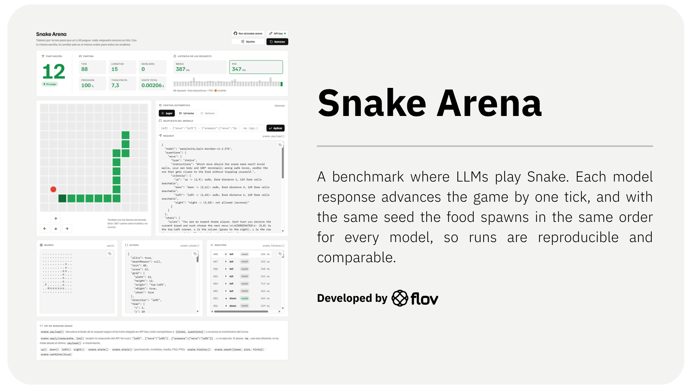

A benchmark where LLMs play Snake. Each model response advances the game by one tick, and with the same seed the food spawns in the same order for every model, so runs are reproducible and comparable.

The project is two self-contained HTML pages with no build step and no dependencies:

| File | What it is |
| --- | --- |
| `snake-arena.html` | Single player: one model (or you) plays one board, with full visibility into the request, world and state. |
| `snake-arena-duel.html` | 1 vs 1 duel: two models play two independent boards that start at the same time, with a live comparison and a winner. |

## Getting started

1. Clone the repo, or just download the HTML file you want.
2. Open it in a browser. If your API provider rejects requests from `file://`, serve the folder locally instead:
   ```bash
   python3 -m http.server 8000
   # then open http://localhost:8000/snake-arena-duel.html
   ```
3. Click **API key**, fill in the endpoint, model ID and key, and press **Save**.
4. Press **Play** (single player) or **Start duel**.

> Requests go straight from your browser to the API, so the provider must allow CORS. Sandboxed previews (such as hosted artifacts) usually block external APIs; open the HTML from your own machine or repo.

## API connection

Each player has its own connection, stored only in your browser's `localStorage`. The key is sent as `Authorization: Bearer <key>` and the model in the `model` field.

| Format | Endpoint example | Request body |
| --- | --- | --- |
| OpenAI (chat completions) | `https://api.example.com/v1/chat/completions` | `{ model, temperature: 0, messages: [system, user] }` |
| OpenRouter Decisions | `https://openrouter.ai/api/alpha/decisions` | `{ model, questions, state }` |
| System One | `https://api.example.com/v1/decisions` | `{ model?, state, questions }` (model is optional) |

- If the endpoint ends in `/v1`, it is completed for you (`/chat/completions`, or `/api/alpha/decisions` for Decisions).
- If the URL and the chosen format don't match (e.g. a `/chat/completions` URL with the Decisions format), the format is corrected automatically.
- In the duel, **Copy from A** fills player B with A's endpoint and key, so you only have to change the model.
- If the response includes `usage.cost`, it is added to the player's total cost.

The response parser is lenient: `up`, `Move: LEFT`, `{"move":"down"}` and `{"answers":{"move":{"choice":"left"}}}` all work.

## Game rules

- Square grid, `(0,0)` at the top-left; `x` grows to the right and `y` grows downward.
- The snake starts with length 3 in the centre, heading right.
- Hitting a wall or your own body ends the game. The tail cell is free on the turn you move (unless you eat).
- Eating food adds one point and one cell of length.
- Reversing 180° or sending something that isn't a direction counts as an **invalid move**: the snake doesn't advance. More than 5 invalid moves in a row loses the game.
- Requests time out after 60 seconds.

## Settings

| Setting | Description |
| --- | --- |
| Seed | Seeds the food generator. Same seed = same food sequence. |
| Board size | 8, 10, 12, 16 or 20. |
| Mode | **Turn-based** (each answer moves one tick) or **Real time** (the snake moves on a timer and answers only turn it). Auto-play always uses turn-based. |
| Hints | Adds the food offset (`dx`/`dy`) and the exact outcome of each move (death, safe, eats food, distance to food, reachable free cells) to the prompt. |
| Tick limit | *Duel only.* Ends a game after N ticks (0 = no limit), so a model that circles without eating doesn't spend forever. |

Seed and size apply on **Reset**.

## Duel

- **Start duel** resets both boards and runs both models until both games end.
- **One turn each** plays a single synchronized round.
- **Synchronized turns**: each round sends both requests at once and waits for both answers. When off, each game advances as fast as its model responds.
- **Download result** saves a JSON file (`snake-duel_<modelA>_vs_<modelB>_seed<N>.json`) with the settings, verdict, duration, and each player's stats and full move history.

The winner is decided in this order:

1. More points.
2. Still alive (reached the tick limit or still playing).
3. Survived more ticks.
4. Faster model (lower P50 latency).

The comparison table shows score, status, ticks, length, invalid moves, accuracy, ticks per food, mean / P50 / P90 latency, total time and cost, with the better value highlighted.

## Manual play

- Single player: arrow keys or the on-screen d-pad. You can also paste a raw model response into **Model response** and press **Apply**.
- Duel: `W A S D` moves player A, arrow keys move player B.

## JavaScript API

Useful for driving the game from the browser console or your own harness.

```js
snake.payload()               // request body for the current format; starts the turn timer
snake.apply(response, {ms})   // apply a raw API response; ms overrides the measured latency
snake.up() / down() / left() / right()
snake.state()                 // board, head, body, food, surroundings, safe moves…
snake.stats()                 // score, invalid moves, accuracy, mean / P50 / P90 latency…
snake.history()               // every move with its event and latency
snake.reset({ seed, size, hints })
snake.setHints(true)
snake.setMode("turn" | "realtime")
```

In the duel page, `snake` is player A and `snakeB` is player B. There is also `window.arena`:

```js
arena.duel()    // start a full duel
arena.step()    // one round
arena.stop()
arena.reset()
arena.result()  // the same object as "Download result"
```

## Debugging

Every request and response is logged to the browser console with a `[snake-arena]` prefix (the key is masked). If a request fails, check the player's log panel and the Network tab.